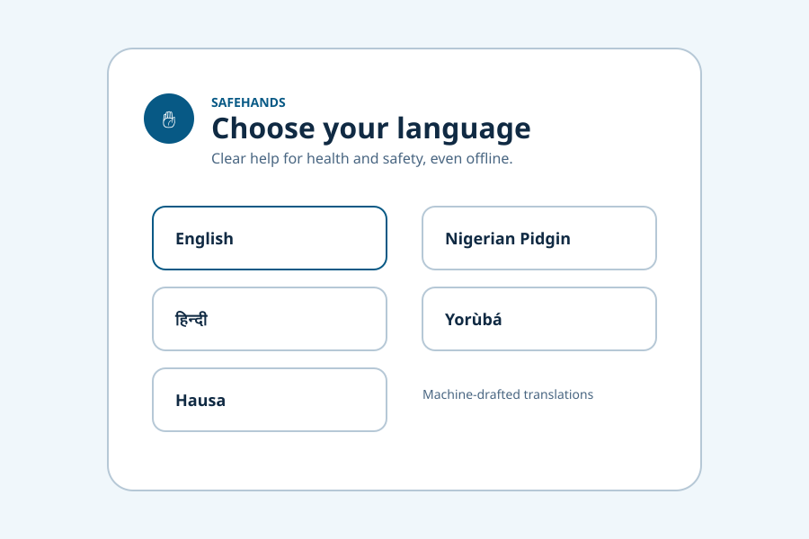
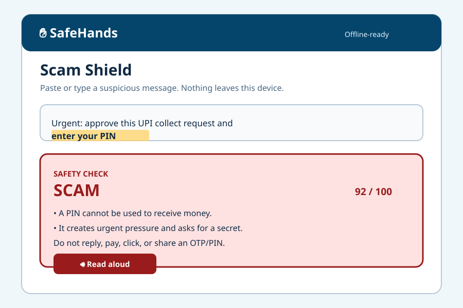

# SafeHands

SafeHands is a free, offline-first installable web app for the Frontier Buildathon **Human × AI** track. It gives people in Nigeria, India, and the wider Global South two plain-language, emergency-first tools:

- **Health triage:** describe symptoms by text, optional voice, or tap-through symptom chips. SafeHands returns a cautious next-step level: emergency, urgent, routine, or monitor.
- **Scam Shield:** paste a suspicious SMS, WhatsApp, UPI, bank, courier, job, loan, or investment message and receive an explainable verdict: `SCAM`, `SUSPICIOUS`, or `LIKELY SAFE`.

The MVP is deliberately small. Core decisions are local, deterministic, and rules-based so the demo and tests work with DNS and network access disabled.

## Who it helps

SafeHands is designed for low-income and low-literacy users, older adults, blind or low-vision users, deaf or hard-of-hearing users, people with motor impairments, first-time smartphone users, and community health workers who need a short hand-off summary.

The interface includes large touch targets, keyboard operation, semantic landmarks, live regions, plain language, voice input where the browser supports it, read-aloud controls, Easy Mode, high contrast, dark mode, reduced motion, dyslexia-friendly text, adjustable text size, local reminders, and a share-target manifest.

## Screenshots

These are lightweight, repository-local preview illustrations. Run the app for the live, interactive screens.





## Quick start on a clean Linux machine

The repository pins Node with `.nvmrc` and commits `package-lock.json`.

```bash
git clone <your-repository-url> SafeHands
cd SafeHands

# With nvm:
nvm install
nvm use

cp .env.example .env
npm ci
npm test
npm run build
```

No `.env` values are required for the MVP. The optional LLM settings are disabled and unused by default.

## Run the app

Development mode:

```bash
npm run dev
```

Open the local URL printed by Vite. For the production bundle:

```bash
npm run build
npm run preview
```

The service worker is registered from the same origin. Load the app once while connected so the shell is cached, then test the triage and Scam Shield flows in airplane mode. The built worker precaches the hashed app assets, protocol JSON, facility JSON, Scam Shield corpus, locales, manifest, and icons.

## Test and build commands

The one required test command is:

```bash
npm test
```

It runs all Vitest suites in jsdom with no network calls:

- deterministic health triage and red-flag precedence;
- deterministic Scam Shield rules, 64 labelled fixtures, precision/recall thresholds, and adversarial inputs;
- locale key parity, language-first UI, privacy boundaries, user paths, and axe-core checks across the major screens.

The complete local gate is:

```bash
npx tsc --noEmit
npm test
npm run build
```

or:

```bash
npm run check
```

The production JavaScript bundle is kept well below the 200 KB gzipped target. The current Vite build is approximately 40.5 KB gzipped for JavaScript.

## Docker rebuild and offline test

Build the image from the repository root:

```bash
docker build -t safehands:local .
```

Run the installable production preview:

```bash
docker run --rm -p 4173:4173 safehands:local
```

Open `http://localhost:4173`.

The exact offline test command required by the buildathon is:

```bash
docker run --rm --network none safehands:local npm test
```

The Dockerfile keeps the test dependencies and source in the image so this command does not need a registry, DNS, or any runtime API. Docker itself must be installed and running on the machine executing these commands.

## Configuration and privacy

Copy `.env.example` to `.env` if you want a local settings file:

```dotenv
VITE_APP_NAME=SafeHands
VITE_ENABLE_OPTIONAL_LLM=false
VITE_OPTIONAL_LLM_BASE_URL=
```

The MVP does not read a secret, call an LLM, collect an account, send analytics, or make a remote API request. Health and scam text is held in memory only for the current view. Preferences and reminders use a small IndexedDB wrapper with a localStorage fallback for restricted web views; raw symptom and message text is not persisted.

The app makes a clear consent/privacy statement in the UI: entries stay on the device, there are no ads, and there is no account requirement. Optional browser geolocation is user-initiated and only sorts the seeded facility list locally; it is not stored or sent.

## Architecture

```text
index.html                  Vite entry and skip link target
src/main.ts                 vanilla DOM UI, speech/share/reminder adapters
src/triage.ts               deterministic health protocol runner
src/scam.ts                 deterministic weighted Scam Shield runner
src/storage.ts              IndexedDB wrapper for non-sensitive settings
src/data/triage-protocol.json
src/data/facilities.json    local Akure seed plus labelled India samples
src/data/scam-fixtures.json 64 India/Nigeria corpus examples
src/data/locales/*.json     English, Nigerian Pidgin, Hindi, Yoruba, Hausa
public/sw.js                development worker; build generates the final list
scripts/generate-sw.mjs     copies local data and precaches every dist asset
tests/                      Vitest + jsdom + axe-core suites
```

There is no heavy framework. Vite bundles TypeScript and JSON locally. The UI imports the deterministic engines directly; there is no runtime dynamic module fetch. The service worker is same-origin only and does not contact an API.

### Health triage rules

`triage()` normalizes case, punctuation, and whitespace, then evaluates hard red flags before presentation rules. A red flag always wins over reassuring wording. Clear negation such as “no chest pain” does not cancel a separate positive danger sign such as “cannot breathe”. Unknown or ambiguous input never receives a reassuring self-care result.

The local protocol covers fever/malaria-like illness without claiming a diagnosis, watery diarrhoea/dehydration and cholera warning signs, cough, breathing difficulty, chest symptoms, FAST/stroke signs, heavy bleeding, pregnancy and postpartum warnings, child danger signs, snakebite, burns, injuries, high-blood-sugar warnings, severe headache, seizures/poisoning/allergy warnings, and mental-health crisis language. Outputs include reasons, three or more short actions, “what not to do”, escalation signs, emergency call numbers, a disclaimer, facility seeds, and a shareable summary.

Hard emergency numbers are selected from context: Nigeria uses `112`; India uses `112` and ambulance `108`; an explicit integration context can provide verified local numbers. The UI keeps a typed/text path even when voice recognition is unavailable.

### Scam Shield rules

`analyzeScam()` is a transparent weighted detector. It keeps exact matched phrases and source offsets for safe `<mark>` highlighting, but never follows or fetches a user link. It checks pressure and threats, OTP/PIN/BVN/NIN/Aadhaar/CVV requests, KYC lures, fake credit/refund claims, UPI collect/PIN-to-receive tricks, courier fees, inheritance/advance-fee offers, jobs/loans/investments/crypto, bank/police/telecom impersonation, digital arrest, WhatsApp takeover, remote access, shortened/look-alike links, suspicious TLDs, and light obfuscation.

Results distinguish `SCAM` from `SUSPICIOUS` and `LIKELY SAFE`. Every non-safe result says to stop replying, avoid links and payments, never share secrets, contact the bank using a known number, preserve evidence, warn a trusted person, and report appropriately. India guidance includes `1930` and `cybercrime.gov.in`; Nigeria guidance includes the bank/wallet, EFCC, Nigeria Police cybercrime unit, and NCC `622` where available.

## Safety and ethics

- **Not a medical device:** SafeHands provides triage and navigation guidance, not diagnosis, prescription, or a guarantee. A result must not be used to rule out serious illness.
- **Emergency first:** call local emergency services immediately for danger signs. Do not wait for a form, voice result, or facility directory when someone is in immediate danger.
- **Hard escalation:** red flags override all lower-urgency matches. If information is unclear, the engine escalates rather than reassures.
- **No secret collection:** the app never asks the user to paste an OTP, PIN, password, full card number, recovery phrase, or other credential. The Scam Shield fixture corpus contains examples, not real credentials.
- **No dark patterns:** no ads, accounts, analytics, forced permissions, or timed decisions. Location and notifications are optional browser capabilities.
- **Care directory limits:** Akure entries are local seed data without invented phone numbers. Indian entries are explicitly `SAMPLE DATA`; confirm names, opening hours, route, and contact details locally before travelling.
- **Translation limits:** non-English strings are machine-drafted and need native speaker review. They are not clinically validated; see [`TRANSLATION_STATUS.md`](TRANSLATION_STATUS.md).
- **Voice limits:** Web Speech API support differs by browser and device. Text, chips, visual alerts, and keyboard operation remain available. Unsupported Yoruba, Hausa, and Pidgin voices fall back honestly to text and a closest available voice when the browser provides one.

## Languages

The first screen uses native-name buttons without flags:

| Code | Language | Status |
| --- | --- | --- |
| `en` | English | source language |
| `pcm` | Nigerian Pidgin | machine-drafted; needs native speaker review |
| `hi` | हिन्दी / Hindi | machine-drafted; needs native speaker review |
| `yo` | Yorùbá / Yoruba | machine-drafted; needs native speaker review |
| `ha` | Hausa | machine-drafted; needs native speaker review |

The locale parity test checks both the bundled JSON key sets and the synchronous UI message maps.

## Limitations and honest boundaries

This is a five-day solo-project MVP, not a clinical service. The rules are intentionally conservative but cannot understand every language, symptom, context, medication, or scam. False positives and false negatives remain possible. Local emergency numbers, facility availability, clinical advice, and translation quality must be checked by qualified local partners before real-world deployment.

The current demo does not provide a verified live facility API, SMS/USSD gateway, WhatsApp gateway, clinician account, cloud sync, server-side CHW dashboard, or on-device speech model. No network-dependent feature is required for the demo or tests. The optional LLM adapter is a documented future seam only and is off by default.

## Roadmap after the MVP

1. Add a reviewed, versioned protocol process with native-language and clinical safety sign-off.
2. Add a real opt-in LLM adapter behind a strict local red-flag guard, with offline fallback and explicit user consent.
3. Add SMS/USSD/WhatsApp gateway integrations without changing the on-device default.
4. Add a reviewed, regularly updated facility directory and CHW sync that is opt-in and encrypted.
5. Add on-device speech models for Nigerian Pidgin, Yoruba, Hausa, and more Indian languages.
6. Add the optional anonymised local CHW view only after the core flows remain green.

## Free-host deployment help

The app is a static Vite site. No server or secret is needed.

### Netlify

1. Push this repository to GitHub or GitLab.
2. In Netlify, choose **Add new site → Import an existing project** and select the repository.
3. Set **Build command** to `npm run build` and **Publish directory** to `dist`.
4. Leave environment variables empty; do not add an API key.
5. Deploy. Open the HTTPS URL once so the service worker can install, then test the language picker, health triage, Scam Shield, and install prompt.

### Vercel

1. Import the repository in Vercel.
2. Keep the detected framework as Vite, or set the build command to `npm run build` and output directory to `dist`.
3. Do not add secrets or an LLM URL for this MVP.
4. Deploy and verify that the site is served over HTTPS. Use the browser's install action and test after switching the device offline.

### GitHub Pages

1. Enable Pages from **GitHub Actions** for the repository.
2. Use a Node 22 workflow that runs `npm ci`, `npm run build`, and uploads `dist` as the Pages artifact.
3. The Vite `base: "./"` setting keeps the shell's asset paths relative for a project site.
4. After the first HTTPS load, verify that `sw.js`, `manifest.webmanifest`, and the local data assets are available under the project path.

These are deployment instructions, not a claim that SafeHands has been deployed from this workspace. A host account and repository access are required for the final publish action.

## Two-minute demo

See [`DEMO.md`](DEMO.md) for the exact scripted demo. The short version is: choose a language, submit “I cannot breathe” through a chip or optional voice, show emergency escalation and read aloud, turn on Easy Mode, paste a UPI PIN-to-receive message, and show the highlighted `SCAM` result with local reporting guidance.

## Buildathon checklist evidence

The red-team matrix and acceptance gates live in [`CHECKLIST_REVIEW.md`](CHECKLIST_REVIEW.md). The final integration pass checks:

- repository history, lockfile, `.nvmrc`, Dockerfile, `.env.example`, and portable relative paths;
- `npm test`, TypeScript, Vite build, locale parity, fixture precision/recall, and axe-core across major screens;
- no secrets, analytics, remote API calls, unsafe link following, raw-input persistence, or unsafe HTML rendering;
- bundle budget, service-worker precache contents, install manifest, emergency-first text, safety disclaimer, and translation status.

## License and contribution safety

This repository is a buildathon MVP. Before accepting clinical content or translations, require a qualified local review, keep changes deterministic and tested, and do not commit private notes, credentials, patient data, or real scam secrets.
